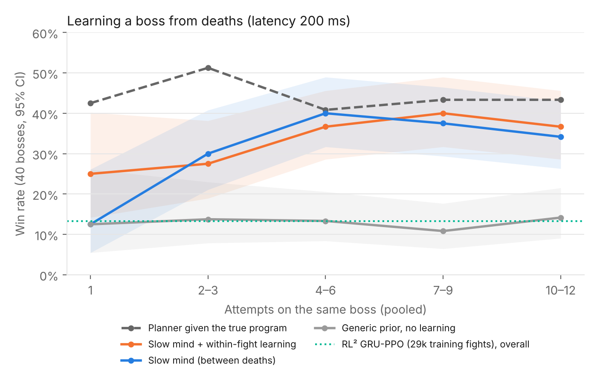
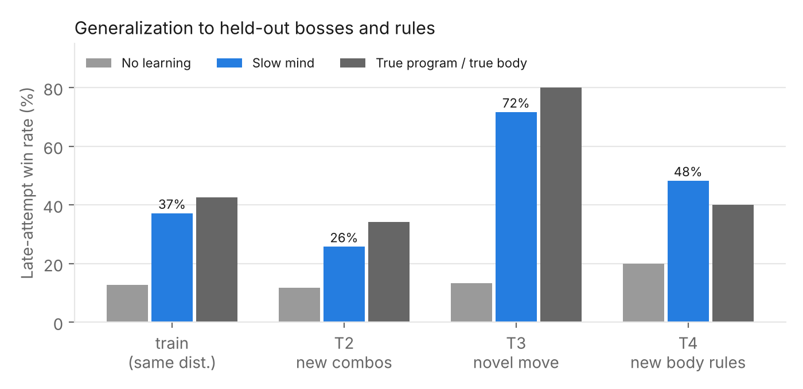

# Reading the Boss: results summary (as of 2026-11-25)

Every number comes from `docs/research-log.md`, which names the entry, script and seeds. Unless stated, results are at **latency 4** (~200 ms, human-like) and win rates carry 95% Wilson CIs.

## Headline: learning a boss from deaths

40 training bosses × 12 consecutive attempts, same seeds in every row (Entry 6).

| Agent | Attempt 1 | Attempts 4–12 |
|---|---|---|
| Planner with the generic prior, no learning | 12.5% | 12.8% [10–17] |
| **Slow mind** (SMC over boss programs between deaths) | 12.5% | **37.2%** [32–42] |
| Planner given the true boss program (oracle) | 42.5% | 42.5% [37–48] |
| RL² (GRU-PPO, memory across attempts, ~29k training fights) | 20% | 13.3% overall, flat (E13) |

Further results for the slow mind:
- It closes **~80% of the prior→oracle gap within 3–4 attempts**. Median deaths-to-first-win is 2.
- The programs it recovers are readable: move count exact for 19/40 bosses and within one move for 34/40, and reactive laws such as "heal → slam" are discovered.
- With zero pretraining it beats a model-free meta-learner given ~29k training fights.

## Generalization (Entry 11)

| Split | What is new | Frozen | Slow mind | Oracle | Gap closed |
|---|---|---|---|---|---|
| T2 | unseen move combinations | 11.7% | 25.8% | 34.2% | 63% |
| T3 | a never-seen move (grab) | 13.3% | 71.7% | 80.0% | 88% |
| T4 | player body rules (another game) | 20.0% | 48.3% | 40.0% | ≥100% |

- **T3:** the novelty proposal adds grab to the program for 30/30 bosses, 25 of them after a single fight.
- **T4:** a learned self-model recovers all of the loss caused by a wrong body model. The ablation shows the gain comes from proprioception (stamina, heal time), not i-frames.

## Cognitive-science findings

1. **Prediction replaces reaction under latency.** Human-like delay costs the true-model planner 30 points (69% → 41%) but makes boss knowledge 2.5× more valuable (E5).
2. **The timing prior barely matters; the structure prior does.** An empirical-Bayes hyperprior fitted from the agent's own 40 learned bosses recovers the true one, but one fight swamps any reasonable timing prior (E7). Structure (which moves exist) is where priors and intuition pay off (E12, E18).
3. **Amortized intuition helps under structural novelty and hurts under parametric shift.** The intuition net beats SMC on a novel move but under-proposes moves on out-of-range timings. The cause is the net's *structure*, and SMC repairs it slowly, because adding moves mixes more slowly than deleting them. **Over-propose, then prune:** a superset proposal (the net's moves plus everything it omitted) gets the best of both (E18). In play on 80 new novel-move bosses it lifts attempts 2–4 from 55.0% to 64.6% (paired p = 0.007, E20).
4. **Information is not value of information.** Information-seeking rolls doubled the speed of self-identification but got the agent killed in early fights, for a parameter that barely affects winning (E15).
5. **Learning inside the fight doubles first-encounter wins.** Re-learning the boss every 10 s mid-fight lifts attempt-1 wins from 8.8% to 21.2% in the confirmatory replication on 80 new bosses (p = 0.013, E22). A pooled table over three experiments (10.7% → 20.7%) is exploratory.
6. **Averaging pays over state, not over programs.** Planning from the single most probable boss *state* costs 6–8 points (E27). Planning from the single best boss *program* costs 2.5 points or less, even with 16 particles (E6, E26). Keeping dormant moves alive as a hedge hurts (E17).
7. **Optimism about one's own future skill is load-bearing (provisional).** Making the imagined player's defence realistic in planning rollouts makes the agent passive and halves its win rate (E24–25). A reviewer notes a confound: the real agent's roll rule was not changed to match. A re-run is queued.
8. **Habits are robust to a wrong model; deliberation exploits a right one.** A reflex distilled from the planner (DAgger, E28) matches a 48-rollout planner at 1/160 of the compute. Acting over the slow mind's learned model, it beats the planner on every T1 attempt (39.6% vs 20.4% mean, p < 10⁻⁴) and quadruples first-encounter wins on T3 (41% vs 11%). After learning, the planner wins on T3 (E29–30).
9. **Habit as a prior for deliberation is the best all-rounder.** Planning with argmax Q + 3·log π_reflex beats the planner on T1 (35.0% vs 20.4%) and on T3 (58.4% vs 51.2%; boss-clustered p = 0.013), and beats the reflex on T3 (E31).

## Ablations (E19)

A move-frequency opponent model (FightingICE-style) reaches only 16.9%, against 13.8% frozen and 33.8% for the full slow mind. Learning *timing* and *structure* carries the gains, and the two partly substitute for each other. Reactive-law inference does not raise win rate (law precision 85%, recall 61%).

## Honest negatives and caveats

- Prequential weighting, the residual-birth move and the regroup split-merge move did not help (E13, E14, E16).
- Environment simplifications are listed in the E4 realism audit: 1D lane, symbolic cues, a single impact tick per move.
- The state-cheat ceiling ignores latency.

---

# Arena3D: 3D motion-captured bosses (as of 2026-11-26)

Source: `docs/arena3d-log.md` (entries B11–B38). Bosses are MuJoCo bodies driven by CMU motion capture, with real 3D contact hitboxes. The agent perceives noisy, delayed keypoints and sounds. Margit-like boss timings are calibrated against public Elden Ring footage (B22). Procedural bosses are random movesets, strings and phase switches built from held-out mocap subjects.

## Margit-like boss (24 paired fights each, 450 HP)

| agent | wins |
|---|---|
| planner, strings guessed (uniform) | 15/24 |
| planner, strings learned by watching, frozen | 18/24 |
| planner, strings learned by watching, **keeps updating in the fight** | **21/24** (vs uniform p = .047) |
| planner, true program | 22/24 (vs uniform p = .018) |
| PPO from scratch (2.1M frames) | 0 (0% damage) |

24 paired seeds (B26 + replication B41). Learned strings that keep updating come within one fight of the true program; the frozen-vs-online difference seen on the first 12 seeds did not replicate. Phase switch: the slow mind adapts inside the first phase-2 fight (22.7% of phase-2 HP vs 3.0% frozen, B19). A policy distilled from it starts level, and PPO fine-tuning collapses it to passivity within 0.25M frames (B37).

## Generalising to unseen procedural bosses

| result | numbers | entry |
|---|---|---|
| engagement drive (pressure grows with time since the last hit) | 7/24 → 35/48 wins (p = .0005) | B28 |
| with a perfect per-move simulator, 18 unseen bosses | 20–23/24 wins per arm (saturated) | B29 |
| learning each boss's physics too (no simulator): drive + after-swing attention + back-off | 21% → 39% damage | B30 |
| + aim model (boss turns toward where I'll be) | +23% survival over 18 bosses (p = .008), 45% damage, 8/36 wins | B33 |
| carrying memory across deaths | ≈ fresh learner each attempt (43.6% vs 41.5%) | B32 |
| + motion-phase clock for delayed swings; **full stack vs naive learner** | 22.7% → **49.5%** damage (p = 2.6e-5), 1 → 7 wins of 36 (p = .028) | B43–B44 |

## Perception and learning findings

- Label-free move discovery improves when the boss's own sequence is used as a perceptual prior: NMI .50 → .61 (shuffled control .45–.48) (B27).
- Early blade-path reading from pose needs near-mocap precision. Clean pose reaches .29 error vs .52 for the average path; 2% keypoint noise already gives .43, and latency costs almost nothing (B34–B36). Hence the design: categorical move identity + per-boss episodic memory of paths.
- Distilling the planner into a habit fails for want of the planner's imagined physics: neither DAgger nor feeding the habit the planner's beliefs closes the 44% → 12% gap (B37–B38).
